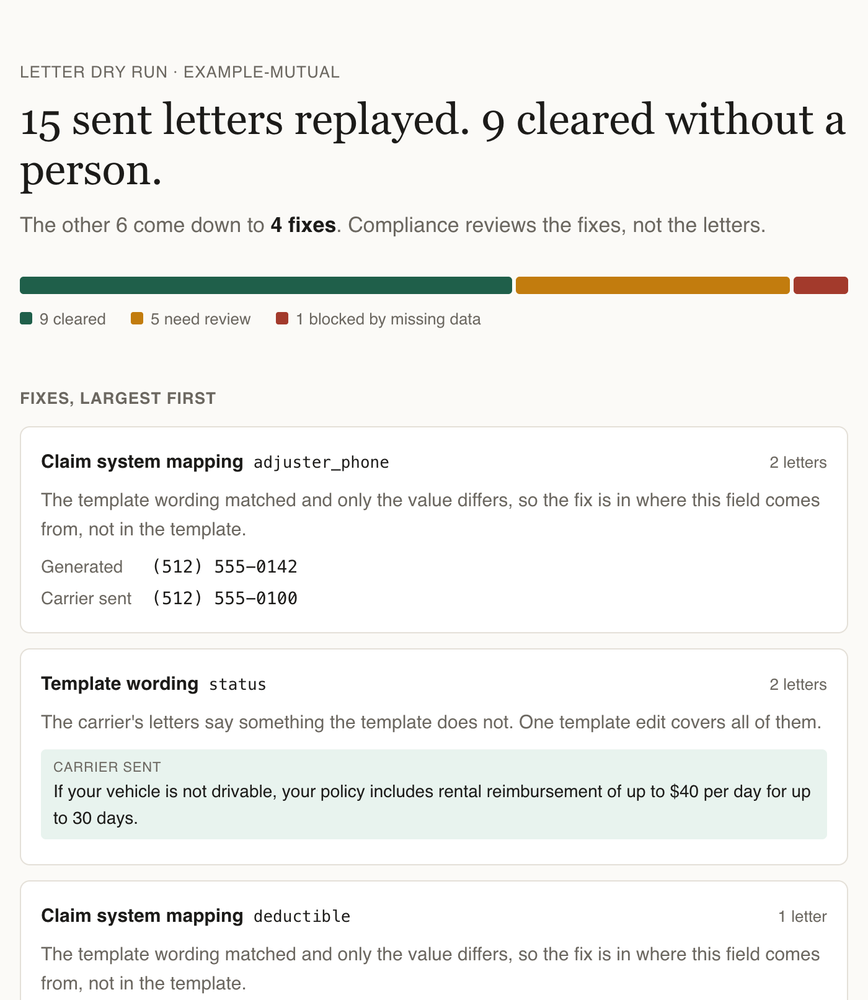

# letter-dry-run

Before a carrier goes live on new claims letter templates, someone has to check that the new templates say what the carrier's letters already said. Reading every letter does not scale.

This tool replays the letters a carrier actually sent. For each one, it regenerates the letter from the claim data and the new template, then compares the two:

- **Cleared**: identical, or only spacing and line endings differ. Nobody reads these.
- **Claim system mapping**: the template wording matched, but a field value differs (the template had `$500`, the carrier sent `$1,000`). The fix is in where that field comes from.
- **Template wording**: the carrier's letter says something the template does not. The fix is a template edit.
- **Missing data**: the claim has no value for a field the template needs, so the letter cannot be generated.

Differences with the same cause are grouped, so reviewers work through a short list of fixes instead of a pile of letters.



## Run it

Needs Node 23.6 or later (it runs the TypeScript directly, with no build step and no runtime dependencies).

```sh
npm run demo        # writes dry-run-report.html for the example carrier
npm test
```

On the example carrier: 15 sent letters, 9 cleared automatically, and the other 6 come down to 4 fixes.

## Carrier folder

```
examples/example-mutual/
  claims.json                       one object per claim, keyed by claim_number
  templates/<name>.txt              {{field}} placeholders, {{#if state = CA}} ... {{/if}} blocks
  sent/<claim>--<template>--<date>.txt   the letters the carrier mailed
```

All claims, names, addresses and letters in the example are synthetic.
